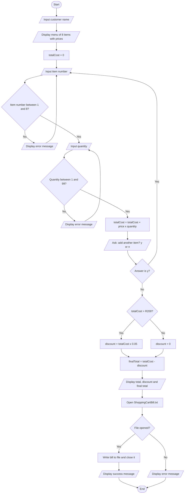

# Question 2.1: Shopping Cart flowchart

The diagram below shows the logic implemented in [`src/q2_shopping_cart.cpp`](../src/q2_shopping_cart.cpp). Rounded boxes are the start and end, parallelograms are input and output, rectangles are processing steps, and diamonds are decisions. GitHub draws it automatically.

